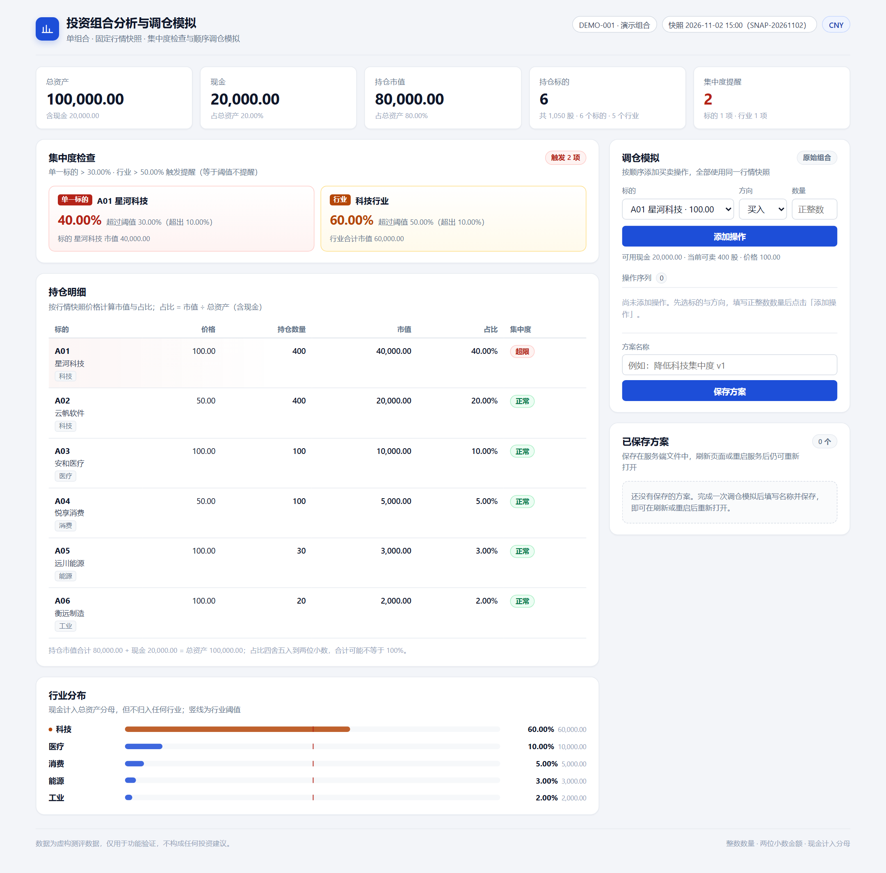
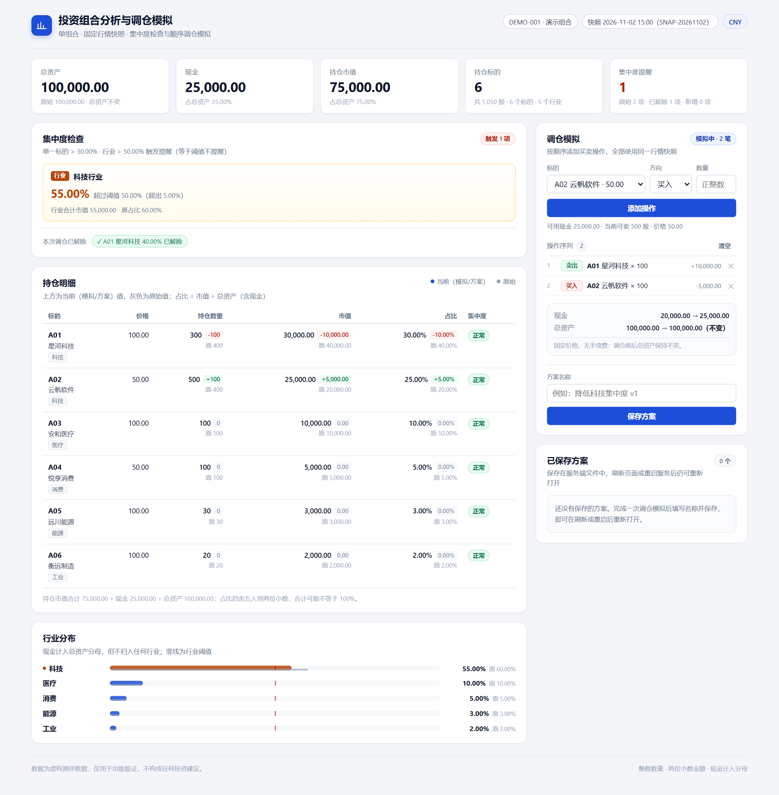

# 投资组合分析与调仓模拟

度小满全栈开发实习技术测评（VC-FIN-001）交付原型。

在**一份固定的行情快照**下查看单个组合的资产结构、识别单一标的与行业的集中度超限，
**按顺序**试算多笔买卖并对比原始/模拟结果，把方案命名保存后**刷新页面或重启服务仍可重新打开**，且原始组合不受影响。

- 后端：Node.js 标准库（`node:http`），**零运行时依赖**
- 前端：原生 HTML / CSS / JavaScript，**无构建步骤**
- 存储：`data/plans.json` 单文件，原子写（临时文件 → rename）
- 测试：`node:test`，37 条断言覆盖 AC-01 ~ AC-05

---

## 1. 环境要求

| 项 | 版本（实测） | 说明 |
| --- | --- | --- |
| 操作系统 | Windows 11（实测；macOS / Linux 预期可用，但未实测） | 无平台相关代码，路径均用 `node:path` |
| Node.js | **v24.15.0**（要求 ≥ 20.0.0） | 用到内置 `fetch`、`node:test`、`node:http` |
| 包管理器 | 不需要 | 无第三方依赖，`npm install` 是空操作 |
| 浏览器 | Edge / Chrome 最新版 | 仅前端渲染需要 |

检查版本：

```bash
node --version    # 应输出 v20.x 及以上
```

## 2. 启动（两步）

```bash
# 1) 进入项目目录（无需 npm install）
cd portfolio-console

# 2) 启动服务
node server.js
```

看到以下输出即启动成功：

```
  投资组合分析与调仓模拟 · 本地原型
  ─────────────────────────────────────────────
  访问地址    http://127.0.0.1:3000
  组合        DEMO-001 演示组合 · 快照 SNAP-20261102
  币种        CNY
  ...
```

浏览器打开 **http://127.0.0.1:3000** 。

换端口：

```bash
node server.js --port 4000
# 或
PORT=4000 node server.js        # Windows PowerShell: $env:PORT=4000; node server.js
```

停止服务：`Ctrl + C`。

## 3. 初始化数据

| 文件 | 说明 |
| --- | --- |
| `data/portfolio.json` | 组合与行情快照，**原样使用任务书示例数据**（DEMO-001 / 2026-11-02 15:00 / CNY）。只读，服务启动时校验并冻结 |
| `data/plans.json` | 已保存方案，初始为空 `{"schemaVersion":1,"plans":[]}`。**由服务写入**，可随时删除以清空方案库（服务会自动重建） |

服务启动时会校验数据口径：若 `rules.comparison` 不是 `strictly_greater_than`、`cash_in_denominator` 不是 `true`、
`fees` 不为 `0.00` 等，会**立刻报错退出**并说明原因，而不是带着错误口径继续算。

## 4. 方案重开步骤（评审复核路径）

1. 打开页面 → 在右侧「调仓模拟」选择 标的 `A01 星河科技`、方向 `卖出`、数量 `100` → 点「添加操作」。
2. 再选择 `A02 云帆软件`、`买入`、`100` → 点「添加操作」。
   - 预期：现金 25,000.00、A02 数量 500、科技行业占比 55.00%、仅剩 1 项行业提醒、总资产仍为 100,000.00。
3. 在「方案名称」填写 `AC-03 降低科技集中度` → 点「保存方案」。
4. 按 `F5` 刷新页面（或 `Ctrl + C` 停止服务后 `node server.js` 重新启动）。
5. 在右下「已保存方案」中点击该方案的「重新打开」。
   - 预期：顶部出现黄色只读横幅；持仓/现金/行业分布与保存时完全一致；原始组合列仍为现金 20,000.00、A01 400、A02 400。

## 5. 目录结构

```
portfolio-console/
├── server.js                  启动入口（端口、日志、优雅退出）
├── src/
│   ├── app.js                 HTTP 服务：路由 / 静态资源 / 错误映射
│   ├── api/handlers.js        接口handler：校验、编排、序列化
│   ├── domain/
│   │   ├── money.js           金额/占比/阈值：整数运算与精确比较
│   │   ├── portfolio.js       组合数据解析、校验、冻结与还原
│   │   ├── engine.js          估值、集中度、顺序模拟（纯函数）
│   │   ├── serialize.js       领域模型 → API DTO（含展示字符串）
│   │   ├── errors.js          AppError 与错误码表
│   │   └── util.js
│   └── store/
│       ├── portfolioStore.js  读取基准组合
│       └── planStore.js       方案文件存储（原子写、写队列、损坏隔离）
├── public/                    前端（index.html / styles.css / app.js）
├── data/                      portfolio.json（只读）· plans.json（可写）
├── tests/                     money / engine / api / acceptance + run-all
├── tools/capture-screenshots.js  真实浏览器截图与端到端断言
├── docs/
│   ├── AI-COLLAB.md           AI 协作记录
│   └── screenshots/           关键页面截图（5 张）
├── PLAN.md                    开工方案（动工前）
├── DESIGN.md                  设计与交付说明
├── VERIFY.md                  验证记录
├── SUBMISSION.md              提交说明与交付清单
├── package.json / package-lock.json
└── .gitignore
```

## 6. 测试

```bash
# 标准方式（Node 内置测试运行器）
npm test
# 等价于
node --test
```

如果所在环境禁止派生子进程（`node --test` 会报 `spawn EPERM`），用单进程方式跑同一套测试：

```bash
npm run test:inproc
# 等价于
node tests/run-all.js
```

预期结果：

```
ℹ tests 37
ℹ pass 37
ℹ fail 0
```

测试覆盖：金额解析/格式化/四舍五入、阈值"等于不触发"、AC-01~AC-05、非法操作与错误码、整组操作原子性、
总资产守恒、模拟与原始隔离、方案冻结与复算一致性、重启后读取、并发保存、`plans.json` 损坏隔离、静态资源与路径穿越。

## 7. 页面截图

对应任务书 4.2 的四类截图：初始组合 → `01-overview.png`；模拟对比 → `02-simulation-compare.png`；
错误反馈 → `03-invalid-operation.png`；已保存方案 → `04-plan-saved.png`（另附重启后重开 `05-plan-reopened-after-restart.png`）。

初始组合（总资产 100,000.00、A01 40%、科技 60% 两项提醒）：



顺序两笔调仓后的对比（现金 25,000.00、科技 55%、A01 提醒解除、上方为模拟值/灰色为原始值）：



| 截图 | 类别 | 场景 |
| --- | --- | --- |
| [03-invalid-operation.png](docs/screenshots/03-invalid-operation.png) | 错误反馈 | 从原始组合买入 A01 201 股被拒绝，显示 `INSUFFICIENT_CASH`、需要 20,100.00 / 可用 20,000.00 与「最多可买入 200 股」建议；操作序列仍为 0 笔 |
| [04-plan-saved.png](docs/screenshots/04-plan-saved.png) | 已保存方案 | 方案保存成功并出现在「已保存方案」列表 |
| [05-plan-reopened-after-restart.png](docs/screenshots/05-plan-reopened-after-restart.png) | 重启后重开（附加） | 重启服务后重新打开方案：只读横幅、结果与保存时一致、原始组合不变 |

重新生成截图（需要本机 Edge/Chrome；脚本会使用临时数据目录，不会污染 `data/plans.json`）：

```bash
npm run screenshots
# 或指定浏览器
BROWSER_PATH="C:\Program Files (x86)\Microsoft\Edge\Application\msedge.exe" node tools/capture-screenshots.js
```

## 8. 接口速查

| 方法 | 路径 | 说明 |
| --- | --- | --- |
| GET | `/api/health` | 健康检查 |
| GET | `/api/portfolio` | 组合概览：总资产/现金/持仓/行业/提醒 + 阈值 |
| GET | `/api/instruments` | 可交易标的与价格 |
| POST | `/api/simulate` | 整组操作试算，返回模拟结果与对比 |
| POST | `/api/plans` | 保存方案（`{name, operations}`） |
| GET | `/api/plans` | 方案列表 |
| GET | `/api/plans/{id}` | 方案详情（复算 + 完整性校验） |

示例：

```bash
curl -s http://127.0.0.1:3000/api/portfolio

curl -s -X POST http://127.0.0.1:3000/api/simulate \
  -H "Content-Type: application/json" \
  -d '{"operations":[{"side":"SELL","symbol":"A01","quantity":100},{"side":"BUY","symbol":"A02","quantity":100}]}'

curl -s -X POST http://127.0.0.1:3000/api/plans \
  -H "Content-Type: application/json" \
  -d '{"name":"AC-03 降低科技集中度","operations":[{"side":"SELL","symbol":"A01","quantity":100},{"side":"BUY","symbol":"A02","quantity":100}]}'
```

错误统一返回：

```json
{"error":{"code":"INSUFFICIENT_CASH","message":"第 1 笔操作：现金不足，买入 201 股 A01 需要 20,100.00 元，可用现金仅 20,000.00 元","details":{"operationIndex":0,"symbol":"A01","side":"BUY","requiredCents":2010000,"availableCents":2000000,"shortfallCents":10000}}}
```

## 9. 计算口径（摘要）

| 概念 | 规则 |
| --- | --- |
| 标的市场价值 | 行情快照价格 × 持仓数量 |
| 组合总资产 | 全部标的市场价值之和 + 现金 |
| 标的占比 | 市值 ÷ 总资产（现金计入分母） |
| 行业占比 | 同行业市值之和 ÷ 总资产（现金不归入任何行业） |
| 提醒阈值 | 单一标的 **> 30%**、行业 **> 50%**；**等于阈值不提醒** |
| 比较精度 | 用展示舍入前的精确值比较（内部：整数分 / 整数 pct2 / 万分比 + BigInt） |
| 展示精度 | 金额与占比均为两位小数 |
| 交易约束 | 数量为正整数；现金不得为负；卖出不得超过当前模拟持仓；全部使用同一快照 |
| 守恒 | 固定价格、无手续费时，调仓前后总资产不变（后端自检） |

## 10. 常见问题

**端口被占用**：`node server.js --port 3001`。

**页面一直转圈 / 提示无法连接本地服务**：确认 `node server.js` 仍在运行，且访问的是它打印的地址。

**方案列表为空，但我保存过**：检查是否在另一个数据目录下启动（服务启动日志会打印「数据目录」）。
删除 `data/plans.json` 后服务会以空方案库重启。

**`data/plans.json` 被手工改坏了**：服务会自动把它重命名为 `plans.json.corrupt-<时间戳>` 并继续启动，方案列表为空，但保存功能仍可用。

**Windows PowerShell 里看到中文乱码**：多为终端编码问题，不影响文件与服务；可 `chcp 65001` 后再试。

**`npm test` 报 `spawn EPERM`**：受限环境禁止子进程，改用 `npm run test:inproc`。

## 11. 已知限制

- 单用户、单组合、单币种（CNY）、固定行情快照，不支持实时行情与真实下单。
- 方案只追加不修改：不支持编辑、删除、复制方案；重新打开为只读查看。
- 价格支持最多两位小数、数量必须为正整数；不支持零股/碎股。
- 方案存储为单文件全量重写，方案数量极大时会变慢（当前场景可忽略）。
- 无鉴权，仅监听 `127.0.0.1`，未做公网部署加固。

更完整的取舍与复盘见 [DESIGN.md](DESIGN.md)，验证过程见 [VERIFY.md](VERIFY.md)，AI 协作记录见 [docs/AI-COLLAB.md](docs/AI-COLLAB.md)。
